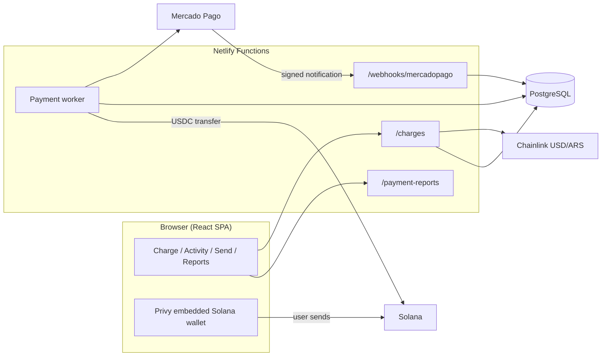

# MidatoPay × Solana: QR and voice payments

**Argentine merchants get paid in pesos through a Mercado Pago QR code and receive the proceeds in USDC on Solana.**

The customer pays in ARS with a Mercado Pago QR code. MidatoPay verifies the payment server-side, and a treasury sends the equivalent amount in native USDC, net of a 0.5% fee, to the merchant's Solana wallet. Every settlement carries an on-chain memo with the charge reference, the ARS amount and the exchange rate.

The merchant logs in with email or phone, and the app creates an embedded Solana wallet for them. From there they can charge and send USDC by typing or speaking, for example "cobrar 5000 pesos" ("charge 5000 pesos") or "enviar 1 dólar a katy" ("send 1 dollar to katy"). Every operation settles on Solana and can be verified on Solana Explorer.

- Repository: `github.com/MidatoPay/solanahackcba`
- Primary network: **Solana** (`mainnet-beta` for production, `devnet` for testing)
- Settlement asset: Circle USDC (SPL Token)
- Payment provider: Mercado Pago (Orders API, dynamic QR)
- Treasury on Solana Mainnet: [`7pCp94zA14dSoQC9wiqoNiPtS96XXEEirAqwbrYmbL5L`](https://explorer.solana.com/address/7pCp94zA14dSoQC9wiqoNiPtS96XXEEirAqwbrYmbL5L)
- Real mainnet transaction: [`3hsY2qzq…STchL4hv`](https://explorer.solana.com/tx/3hsY2qzqthv6VHXPuNC7F1cvGCq333Gkk5SDyJbWVaeFbEEYaDyco6pzEY72qjip8BKZUPNCp22w16G1STchL4hv)

---

## Table of contents

1. [Problem and product](#1-problem-and-product)
2. [Architecture](#2-architecture)
3. [Charge and settlement flow](#3-charge-and-settlement-flow)
4. [Fee](#4-fee)
5. [Solana and USDC](#5-solana-and-usdc)
6. [Installation and configuration](#6-installation-and-configuration)
7. [Commercial traction](#7-commercial-traction)
8. [Repository map](#8-repository-map)
9. [Further documentation](#9-further-documentation)

---

## 1. Problem and product

Small and mid-sized Argentine merchants are mostly paid in pesos, and many of them get paid by QR. Their problem is less about *how* they get paid and more about *what they can do with the money afterwards*. Pesos lose value between the sale and the moment the merchant uses that money, and paying a supplier in dollars is slow or simply not possible.

MidatoPay changes nothing at the counter. It changes what the merchant ends up holding:

| Actor | Experience |
|---|---|
| Customer | Scans a Mercado Pago dynamic QR code and pays in ARS, with no crypto wallet and no new app. |
| Merchant | Logs in with email or phone (Privy) and gets a Solana wallet automatically. Types or says the amount ("cobrar 5000 pesos"), shows the QR code, and sees "Payment received" followed by the USDC credit. |
| Platform | Verifies the payment with Mercado Pago, settles USDC from a prefunded treasury and records the fee. |

The app also includes:

- **Activity:** history with a Solana Explorer link for every settlement.
- **Send:** USDC transfers to contacts or addresses.
- **Voice charges.**
- **Contacts.**
- **Business profile** (see below).
- **Operations and commissions reports** for administrators (see below).
- **Languages:** English and Spanish.

### Business name

- Each user can save or clear their business name under **Profile → Business name**.
- The name appears in Activity and in the QR header. If it is empty, the Privy user name is used instead.
- The `merchant_profiles` table links both names to the authenticated Privy DID. Before deploying this version, apply `db/migrations/20261016_merchant_profiles.sql`, which is already included in `npm run db:migrate:payments`.
- The authenticated `/merchant-profile` endpoint returns the profile with GET and updates only `businessName` with PATCH.

### Administrator access

Users listed in `PAYMENTS_ADMIN_USER_IDS` open **More → Operations and commissions**. There they see the history of every merchant, with filters, totals and CSV export.

---

## 2. Architecture

MidatoPay is built as follows:

- **Application:** a Vite + React SPA served by Netlify.
- **Backend:** Netlify Functions.
- **State:** PostgreSQL.
- **Settlement:** standard SPL Token, associated token account and SPL Memo instructions, through `@solana/kit` v8. There is no custom on-chain program.



| Layer | Main files |
|---|---|
| Frontend | `src/App.jsx`, `src/MercadoPagoCharge.jsx`, `src/solana.js`, `src/network.js` |
| Charges and Mercado Pago | `netlify/functions/charges.js`, `lib/paymentService.js`, `lib/mercadopago.js`, `lib/merchantPos.js` |
| Webhook and worker | `netlify/functions/mercadopago-webhook.js`, `lib/paymentWorker.js` |
| Treasury | `lib/treasuryPayout.js` |
| Reports | `netlify/functions/payment-reports.js`, `lib/paymentReporting.js` |
| Data | `db/schema.sql`, `db/migrations/*.sql` |

---

## 3. Charge and settlement flow

1. **The merchant creates the charge.** They enter the amount in ARS. The server verifies their session and wallet, reads the ARS/USD rate from Chainlink, computes the fee and the USDC to deliver, and reserves that liquidity in the treasury.
2. **The QR code is generated.** MidatoPay creates a dynamic QR order in Mercado Pago, on the merchant's own point of sale. The rate stays locked for 15 minutes (see [Quote freshness](#quote-freshness)).
3. **The customer pays** in pesos by scanning the QR code.
4. **MidatoPay verifies the payment** with Mercado Pago, through the signed webhook and an order lookup. A payment only counts as paid if the amount, seller, point of sale and currency match exactly.
5. **The treasury settles in USDC.** It sends the USDC to the merchant's Solana wallet and pays the network fee, so the merchant needs no SOL. The transaction includes a memo with the charge reference, the ARS amount and the rate.
6. **Delivery is confirmed.** Once the transaction is finalized on Solana, the charge becomes "delivered" and the fee is recorded exactly once.

The merchant follows the progress on screen: QR code, "Payment received", "Confirmed" and "USDC credited".

### Quote freshness

With real money, a stale price could be arbitraged against the treasury. That is why every charge requires a current quote from the Chainlink USD/ARS feed:

- `CHAINLINK_MAX_AGE_SECONDS` sets the maximum accepted quote age. It is required and its value is **90000 seconds (25 hours)**: the feed's published heartbeat (86400 s) plus one hour of margin.
- If the latest round is older than that maximum, the charge is rejected with `quote_stale`: no QR code is created and no liquidity is reserved.
- If the variable is missing or is not a positive integer, no charges are created (`missing_chainlink_max_age_seconds` / `invalid_chainlink_max_age_seconds`).
- The admin configuration check shows the quote age, the configured maximum and the heartbeat.

---

## 4. Fee

MidatoPay charges a **fixed 0.5% fee** on the peso amount of each charge.

- **Who pays it:** the merchant. It is deducted before converting to USDC.
- **The customer** pays exactly the QR amount, with no surcharge.
- **Other costs:** MidatoPay absorbs Mercado Pago's costs and Solana network fees.

**Example** (verified in `test/payments.test.js`):

| Item | Value |
|---|---|
| Customer pays | ARS 10,000.00 |
| Fee (0.5%) | ARS 50.00 |
| Amount converted | ARS 9,950.00 |
| Rate | 1,650 ARS per USD |
| Merchant receives | 6.030303 USDC |

The proposition is simple: one percentage, no hidden spread. The merchant knows the exact USDC amount before charging, and settlement is automatic end to end.

---

## 5. Solana and USDC

### 5.1 Why Solana

- **USDC is native on Solana.** Circle issues it directly as an SPL token, so no bridges or wrapped tokens are needed.
- **Fees are low and independent of the amount.** Settling each charge costs a marginal amount compared with the fee, and the platform can pay it on the merchant's behalf.
- **Confirmation is fast.** The merchant sees the credit within seconds.
- **Wallets are embedded.** Privy creates the Solana wallet at login, with no seed phrases.
- **Traceability is on-chain.** Every settlement links the Mercado Pago reference, the ARS amount and the exchange rate to a public signature.

### 5.2 Stack and tools

- Circle USDC (SPL Token), on mainnet and devnet
- SPL Memo, which carries the charge reference
- PostgreSQL for charges, contacts and history
- `@solana/kit` v8
- `@solana-program/token`, `@solana-program/memo` and `@solana-program/system`
- Privy (`@privy-io/react-auth`, `@privy-io/server-auth`)
- Solana Explorer links

### 5.3 On-chain activity on Solana Mainnet

- **MidatoPay treasury:** [`7pCp94zA14dSoQC9wiqoNiPtS96XXEEirAqwbrYmbL5L`](https://explorer.solana.com/address/7pCp94zA14dSoQC9wiqoNiPtS96XXEEirAqwbrYmbL5L). Its transaction history lists the USDC settlements sent to merchants.
- **Real transaction:** [`3hsY2qzqthv6VHXPuNC7F1cvGCq333Gkk5SDyJbWVaeFbEEYaDyco6pzEY72qjip8BKZUPNCp22w16G1STchL4hv`](https://explorer.solana.com/tx/3hsY2qzqthv6VHXPuNC7F1cvGCq333Gkk5SDyJbWVaeFbEEYaDyco6pzEY72qjip8BKZUPNCp22w16G1STchL4hv) on Solana Mainnet.

### 5.4 How to verify a settlement

1. Open a delivered charge in **Activity** and follow its **Solana Explorer** link, or open the [real transaction above](https://explorer.solana.com/tx/3hsY2qzqthv6VHXPuNC7F1cvGCq333Gkk5SDyJbWVaeFbEEYaDyco6pzEY72qjip8BKZUPNCp22w16G1STchL4hv) or any transaction from the [treasury](https://explorer.solana.com/address/7pCp94zA14dSoQC9wiqoNiPtS96XXEEirAqwbrYmbL5L).
2. Confirm three things:
   - the USDC transfer from the treasury to the merchant's wallet;
   - the memo `MIDATO|v1|inv:mp_…|kind:charge_mercadopago|…`;
   - the `finalized` status.
3. Compare the memo's `inv` with the Mercado Pago order reference, and its `amt` and `fx` fields with the charge.

---

## 6. Installation and configuration

Requirements:

- Node.js 22
- npm
- a Privy app with Solana embedded wallets
- PostgreSQL
- a Mercado Pago seller account

### 6.1 Quick start (frontend only)

```bash
npm install
cp .env.example .env   # fill in the keys (see the table below)
npm run dev            # http://localhost:5173
```

### 6.2 Full environment (frontend + Functions + charges)

```bash
npm ci
cp .env.example .env          # local / devnet
npm run payments:env          # adds missing payment variables
npm run db:migrate:payments   # applies the migrations
npm run payments:check        # read-only configuration check
npm run dev:full              # Vite + Functions at http://localhost:8888
```

Use `.env.production.example` as the checklist for the Netlify **Production** context. Never commit a completed file.

### 6.3 Environment variables

Installable webapp setup and icon instructions: [`docs/WEBAPP.md`](docs/WEBAPP.md).

| Variable | Purpose |
|---|---|
| `VITE_PRIVY_APP_ID`, `PRIVY_APP_SECRET` | Privy app |
| `VITE_SOLANA_CLUSTER` | `mainnet-beta` or `devnet` |
| `SOLANA_RPC`, `VITE_SOLANA_WSS` | Solana RPC |
| `TREASURY_SECRET_KEY` | Treasury keypair (server-side only) |
| `MP_ENVIRONMENT`, `MP_ACCESS_TOKEN`, `MP_USER_ID`, `MP_STORE_ID`, `MP_WEBHOOK_SECRET` | Mercado Pago |
| `ETH_RPC_URL` | Chainlink USD/ARS quote |
| `CHAINLINK_MAX_AGE_SECONDS` | Maximum quote age: `90000` (25 h) |
| `CONVERSION_FEE_BPS` | `50` |
| `PAYMENTS_BASE_URL`, `INTERNAL_WORKER_SECRET` | Payment worker |
| `PAYMENTS_ENABLED` | Enables charges |
| `PAYMENTS_ADMIN_USER_IDS` | Administrators |
| `AIVEN_PG_URL`, `AIVEN_PG_CA_CERT` | PostgreSQL |
| `ANTHROPIC_API_KEY` | Voice charges (optional) |

### 6.4 Configure Privy

1. Go to https://dashboard.privy.io and create an app.
2. Under **Login methods**, enable Email and SMS.
3. Under **Embedded wallets**, enable automatic creation of **Solana** wallets.
4. Under **Domains**, add `http://localhost:5173`, `http://localhost:8888` and the deployment domain.
5. Copy the App ID into `VITE_PRIVY_APP_ID`.

The full production go-live guide is in `docs/MERCADOPAGO_PRODUCCION.md`.

USDC sends through manual entry, QR and voice use the user's primary Privy wallet (index 0), with the user's signature and SOL costs covered by treasury. Two daily sends per user and a configurable global budget apply. General access defaults to disabled; `TRANSFERS_ALLOWED_USER_IDS` enables selected Privy users for a production pilot. See the [transfer operations guide](docs/USDC_TRANSFERS.md).

---

## 7. Commercial traction

The `business-lois/` folder contains two letters of intent: one from a distribution channel and one from a merchant.

**Deenex Technologies S.A.S.** (16 May 2026, `business-lois/Carta_Intencion_Deenex_MidatoPay.pdf`). Deenex is an omnichannel platform for food-service chains in Argentina. In the letter, Deenex intends to:

- offer MidatoPay to its whole network, which currently has **500 active locations** and is projected to reach 2,000 by December 2026;
- support MidatoPay with a pilot, training and merchant onboarding.

**Supermercado Soler** (26 November 2025, `business-lois/Carta_Intencion_Wang_Midatopay.pdf`), signed by its owner. In the letter, the supermarket:

- states its formal interest in MidatoPay as a tool to protect the value of its daily cash against inflation and devaluation, by converting peso revenue into digital dollars (stablecoins);
- highlights MidatoPay's model of **pooled volume purchasing with other supermarkets**, which could offer better conversion rates and operational benefits;
- asks for a product demo and wants to evaluate a pilot in its operations.

---

## 8. Repository map

```
src/                     React SPA
netlify/functions/       HTTP and scheduled Functions
netlify/functions/lib/   Payment core, worker, Mercado Pago client, treasury
db/                      Schema and migrations
scripts/                 Environment setup, checks and migrations
test/                    Tests
docs/                    Operations and integration guides
business-lois/           Letters of intent (Deenex, Supermercado Soler)
```

---

## 9. Further documentation

- [`datosadicionales.md`](datosadicionales.md): why MidatoPay is a strong fit for the Solana ecosystem, covering its capabilities, commercial proposition and adoption potential.
- [`docs/MERCADOPAGO_PRODUCCION.md`](docs/MERCADOPAGO_PRODUCCION.md): operations guide for Mercado Pago → USDC (Spanish).
- [`docs/USDC_TRANSFERS.md`](docs/USDC_TRANSFERS.md): primary wallet, USDC sends, production pilot and recovery (Spanish).
- [`SOLANA-RULES.md`](SOLANA-RULES.md): Solana engineering rules.
